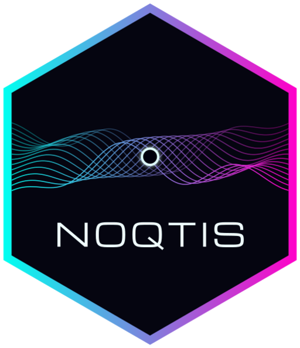

# noqtis 

[](https://noqtis.dev/)
[](https://github.com/rootcoder007/noqtis/actions/workflows/ci.yml)
[](https://github.com/rootcoder007/noqtis/actions/workflows/cov.yml)
[](https://github.com/rootcoder007/noqtis/actions/workflows/r.yml)
[](https://github.com/rootcoder007/noqtis/actions/workflows/fuzz.yml)
[](https://github.com/rootcoder007/noqtis/actions/workflows/docs.yml)
[](https://www.bestpractices.dev/projects/16049)
[](https://github.com/rootcoder007/noqtis/releases/latest)
[](https://pypi.org/project/noqtis/)
[](https://www.npmjs.com/package/noqtis)
[](https://crates.io/crates/noqtis)
[](https://central.sonatype.com/artifact/io.github.rootcoder007/noqtis)
[](https://pkg.go.dev/github.com/rootcoder007/noqtis/bindings/go)
[](https://rootcoder007.r-universe.dev/noqtis)
[](https://copr.fedorainfracloud.org/coprs/rootcoder007/noqtis/)
[](https://build.opensuse.org/package/show/home:rootcoder007/noqtis)

Documentation and guides: <https://noqtis.dev/>.

Post-quantum signatures (ML-DSA, SLH-DSA, hybrids with Ed25519), key
encapsulation (ML-KEM, HQC), SHA-2/SHA-3 hashes, sealed file capsules and
DSSE envelopes for JavaScript: the
[noqtis](https://github.com/rootcoder007/noqtis) C11 library compiled to
WebAssembly. One package for Node (22 and later), browsers, Deno and Bun;
nothing to compile, no dependencies, no network access.

```sh
npm install noqtis
```

## Use

```js
import { init, sign, kem, hash } from 'noqtis';

await init(); // once: loads noqtis.wasm

const { publicKey, secretKey } = sign.keygen('ML-DSA-65');
const sig = sign.sign('ML-DSA-65', secretKey, 'a message', { ctx: 'app-v1' });
sign.verify('ML-DSA-65', publicKey, 'a message', sig, { ctx: 'app-v1' }); // true

const kp = kem.keygen('ML-KEM-768');
const { ciphertext, sharedSecret } = kem.encap('ML-KEM-768', kp.publicKey);
kem.decap('ML-KEM-768', kp.secretKey, ciphertext); // equals sharedSecret

hash('sha3-256', 'abc'); // Uint8Array(32)
```

CommonJS works the same way: `const nq = require('noqtis'); await nq.init();`.

Bytes go in and come out as `Uint8Array` (a `Buffer` is one). Messages,
contexts and hash input may also be strings, taken as UTF-8. Every call
after `init()` is synchronous.

## API

| Call | Returns |
|---|---|
| `init({ wasm })` | a promise; `wasm` is noqtis.wasm as bytes, a `WebAssembly.Module` or a `Response`, and on Node, Deno and Bun also a path or `file:` URL; optional there (the package's own file is read), required in a browser |
| `algs()` | every algorithm with its sizes in bytes: `{ name, kind: 'sign', publicKey, secretKey, signature }`, `{ name, kind: 'kem', publicKey, secretKey, ciphertext, sharedSecret }`, `{ name, kind: 'hash', digest }` |
| `sign.keygen(alg, { seed })` | `{ publicKey, secretKey }`; `seed` is the standard's seed (xi, 32 bytes, for ML-DSA; SK.seed, SK.prf, PK.seed for SLH-DSA; the 32-byte private key for Ed25519; xi and the Ed25519 key, 64 bytes, for a hybrid) |
| `sign.sign(alg, sk, msg, { ctx, deterministic, rnd, prehash })` | the signature (FIPS 204/205 encoding); `ctx` at most 255 bytes; `deterministic` uses all-zero per-signature randomness; `prehash` names a hash for HashML-DSA / HashSLH-DSA |
| `sign.verify(alg, pk, msg, sig, { ctx, prehash })` | `true` or `false` (`false` also for a malformed signature) |
| `kem.keygen(alg, { seed })` | `{ publicKey, secretKey }` |
| `kem.encap(alg, pk)` | `{ ciphertext, sharedSecret }` |
| `kem.decap(alg, sk, ct)` | the shared secret; a tampered ciphertext gives an unrelated secret, not an error (implicit rejection, as FIPS 203 and HQC require) |
| `hash(alg, data, { length })` | the digest; `length` for SHAKE only |
| `hmac(alg, key, data)` | HMAC with a SHA-2 or SHA-3 hash |
| `random(n)` | `n` bytes from `crypto.getRandomValues` |
| `capsule.seal(files, alg, sk, pk, { meta, time, format, inputs })` | `{ 'noqtis.json', 'noqtis.sig' }`; `format: 2` adds a Merkle tree over the files; `inputs: [{ name, id }]` records the capsules it was made from |
| `capsule.check(files, { trust, anchors, only, lineage, keys, proof })` | `{ ok, code, checks: [{ check, ok, detail }] }` |
| `capsule.id(files)` | the capsule's id, 32 bytes (nothing checked) |
| `capsule.prove(files, paths)` | a proof (JSON bytes) that `paths` are in the format 2 capsule |
| `capsule.files(files)` | `[{ path, size, sha256 }]` as the manifest lists them (nothing checked) |
| `capsule.rotate(alg, sk, pk, newAlg, newSk, newPk, { at, reason })`, `capsule.revoke(alg, sk, pk, { at, reason })` | a key statement (JSON bytes) for `check`'s `keys` |
| `idcard.make(alg, sk, pk, { name, orcid, email, url, affil }, { at })` | an identity card (JSON bytes) for the key, signed by it; the ORCID check digit is verified |
| `idcard.verify(card, { trust })` | `{ name, orcid, email, url, affil, created, alg, publicKey, keySha256 }`, or `null` when it does not verify or is not `trust`'s |
| `dsse.sign(alg, sk, pk, type, payload)` | a DSSE envelope (canonical JSON bytes) |
| `dsse.verify(alg, pk, envelope)` | `{ payload, payloadType }`, or `null` when no signature verifies |
| `keyfile.encode(alg, 'pub' \| 'sec', key)`, `keyfile.decode(text)` | the CLI's key file text, and back (`{ alg, kind, key }`) |
| `NoqtisError`, `codes`, `errmsg(code)` | errors carry the library's `NQE*` code in `.code` and its message |
| `version()` | the library version |
| `selftest()` | runs the library's known-answer self-test; throws (code `EKAT`) when an answer differs |

Algorithm names are the standards' (`ML-DSA-44`, `ML-DSA-65`, `ML-DSA-87`,
`SLH-DSA-SHA2-128s` ... `SLH-DSA-SHAKE-256f`, the hybrids
`ML-DSA-44+Ed25519` ... `ML-DSA-87+Ed25519`, `Ed25519` (classical, not for
seals), `ML-KEM-512`, `ML-KEM-768`,
`ML-KEM-1024`, `HQC-128`, `HQC-192`, `HQC-256`); case does not matter.
Hashes: `sha224 sha256 sha384 sha512 sha512-224 sha512-256 sha3-224
sha3-256 sha3-384 sha3-512 shake128 shake256`.

A failure throws `NoqtisError`: an unknown algorithm is `ENOSUP`, a bad
argument (a context over 255 bytes, a seed of the wrong length) `EARG`, a
key of the wrong length `EDEC`, a failed random source `ERNG`. A signature
that does not verify is `false`, not an error.

## Capsules

A capsule is a folder with `noqtis.json` (a manifest of every file's
SHA-256 and SHA3-256) and `noqtis.sig` (its signature); the format is in
the main repository's docs/spec/capsule.md. In JavaScript a capsule is a map of
`'/'`-separated relative paths to file contents, so sealing and checking
work in browsers too:

```js
const files = new Map([['data/a.csv', bytesA], ['README', 'text']]);
const seal = capsule.seal(files, 'ML-DSA-65', secretKey, publicKey,
  { meta: { project: 'x' } });
// store seal['noqtis.json'] and seal['noqtis.sig'] beside the files
for (const [name, b] of Object.entries(seal)) files.set(name, b);
capsule.check(files, { trust: publicKey }).ok; // true
```

Without `trust`, `check` accepts the key the seal carries and its report
says so. `anchors` takes the DER certificates of RFC 3161 timestamp
authorities, for seals that carry a timestamp token; the library itself
makes no network requests, so it cannot obtain one: seal with the CLI's
`noqtis seal --tsa <url>` to add one.

### Format 2, proofs, lineage and key statements

```js
const out = capsule.seal(files, 'ML-DSA-65', sk, pk, { format: 2 });
// ... files now holds noqtis.json and noqtis.sig too
const proof = capsule.prove(files, ['data/a.csv']);
capsule.check(null, { proof, trust: pk }).ok;   // the proof alone
capsule.check(files, { proof, trust: pk }).ok;  // and the proven files
```

A proof holds the seal, the manifest's head and each proven file's entry
and Merkle audit path, and nothing of the other files.
`seal(..., { inputs: [{ name: 'raw', id: capsule.id(raw) }] })` records
the capsules one was made from; `check(files, { lineage: [raw] })` finds
each among those capsules by id and checks it, to 64 levels.
`check(files, { only: ['data/a.csv'] })` checks just those files and says
so in `partial` rows and in `partial: true` on the result.

`capsule.rotate` and `capsule.revoke` write key statements; pass them to
`check` as `keys` with `trust`. A seal by a key the trusted key was
rotated to then checks, and a seal by a key rotated away or revoked
needs a verified timestamp from before that time. Ed25519 alone cannot
make statements, or seals.

## Identity cards

```js
const card = idcard.make('ML-DSA-65', sk, pk,
  { name: 'Ada Lovelace', orcid: '0000-0002-1825-0097' });
idcard.verify(card, { trust: pk }); // { name, orcid, ..., keySha256 } or null
```

A card (noqtis-idcard-1) binds the key to its holder's name and, when
given, ORCID iD, e-mail address, https:// page and affiliation, signed
by the key under its own context, so it is never a seal or a key
statement. It is self-signed: compare `keySha256` with the one its
holder published, or pass `trust`. A field out of its limits throws
`NQEARG`; input that is not a card, `NQEDEC`.

## DSSE envelopes

```js
const env = dsse.sign('ML-DSA-65', sk, pk, 'application/vnd.in-toto+json',
  statement);
dsse.verify('ML-DSA-65', pk, env); // { payload, payloadType } or null
```

The envelope (the in-toto and SLSA signing wrapper) has one signature
over the pre-authentication encoding; its keyid is the hex SHA-256 of
the public key. Text that is not an envelope throws `EDEC`.

On Node, `noqtis/node` reads a folder from disk and writes the seal back:

```js
import { checkDir, sealDir } from 'noqtis/node';
sealDir('out', 'ML-DSA-65', secretKey, publicKey);
checkDir('out', { trust: publicKey });
checkDir('model', { lineage: ['raw', 'clean'] }); // folders work here
```

A link or a special file in the folder is refused, as the C library
refuses it. The files are held in memory while they are checked; for
very large capsules use the `noqtis` command-line tool, which streams.
The CommonJS `require('noqtis/node')` functions return promises.

## Passphrase keys, streams and sealed files

```js
import { keyfile, kem, sign } from 'noqtis';
import { createReadStream } from 'node:fs';

const text = keyfile.encode('ML-DSA-65', 'sec', secretKey,
  { passphrase: 'a passphrase' });
const k = keyfile.decode(text, { passphrase: 'a passphrase' }).key;

const s = sign.signer('ML-DSA-65', k);
for await (const piece of createReadStream('big.csv')) s.update(piece);
const sig = s.sign();                          // sign.sign's bytes

const sealed = [];
for await (const p of kem.box('ML-KEM-768', kemPk, createReadStream('big.csv'))) {
  sealed.push(p);                              // the noqtis box format
}
```

`sign.verifier`, `hasher`, `kem.sealer` and `kem.opener` are the other
streams; `kem.seal` and `kem.open` a message; `sign.mu`, `signmu` and
`verifymu` ML-DSA with an external mu; `blake2b`, `argon2id`, `pbkdf2`
and `cteq` the primitives. `capsule.inspect`, `sealWhy`, `tsreq`, `tsput`,
`ersreq`, `ersput`, `pack`, `unpack` and `chain` reach the rest of the
capsule functions (on files in memory, returning what changed);
`data.key`, `del`, `synth`, `calibrate`, `chunks`, `piece`, `commit`,
`reveal`, `commitment`, `cite`, `report` and `env` the rest of the data
layer (`noqtis/node`'s `packages()` reads a `package-lock.json` for
`env`).

`kt128` and `kt256` are KangarooTwelve (RFC 9861); `sivenc` / `sivdec`
AES-SIV (RFC 5297) and `gsivenc` / `gsivdec` AES-GCM-SIV (RFC 8452),
authenticated encryption; `chacha20` the ChaCha20 stream of RFC 8439,
which is not authenticated.

## Mail, OpenPGP, a key store and tokens

`armor` and `mail` write text armor (RFC 7468), X.509 certificates for
noqtis keys, and CMS and S/MIME messages, signed or encrypted. The `pgp`
functions make version 6 OpenPGP keys (RFC 9580) and sign, verify,
encrypt and decrypt with them. The `keystore` functions keep other
people's public keys, certify them and carry them from one store to
another. The store's files are held by the caller, and tokens
are not reached from WebAssembly.

```js
import { init, pgp } from 'noqtis';
await init();

const k = pgp.generate('Ada Example <ada@example.org>');
const sig = pgp.sign(k.secretKey, 'a message', { mode: 'detached' });
pgp.verify(k.certificate, sig, { content: 'a message' });   // null when it does not verify
```

## Security notes

- Randomness comes only from `crypto.getRandomValues`; if it is missing
  or fails, the call throws `ERNG`. There is no fallback.
- Every buffer the wrapper places in WebAssembly memory (keys, seeds,
  messages, shared secrets) is wiped before it is freed. The `Uint8Array`
  results you receive are ordinary JavaScript memory: wipe them yourself
  (`sk.fill(0)`) when done. JavaScript strings cannot be wiped, so pass
  secrets as `Uint8Array`.
- The C code is constant time on secret data; the WebAssembly engine's
  compiler is not under our control, and the JavaScript base64 coder in
  `keyfile` avoids table lookups but cannot promise constant time.

## Bundlers and other runtimes

The package is ESM with a CommonJS entry and `sideEffects: false`. On
Node, Deno and Bun (the `node` export condition) `init()` reads the
package's own `dist/noqtis.wasm`, its one file read. The browser entry
reads no file and makes no request: pass the module yourself, from your
own fetch or your bundler's asset import of `noqtis/noqtis.wasm`:

```js
import { init } from 'noqtis';
// serve node_modules/noqtis/dist/noqtis.wasm with your site, then
await init({ wasm: await fetch('/assets/noqtis.wasm') });
// or with Vite: import url from 'noqtis/noqtis.wasm?url';
//               await init({ wasm: await fetch(url) });
```

The JavaScript is plain, unminified source: `lib/index.js` (the API),
`lib/wasm.js` (instantiates the module), `lib/wasi.js` (the few host
functions the C library calls: `crypto.getRandomValues` for randomness,
the clock, and an in-memory folder for capsules; nothing else, no
network, no environment). Without `crypto.getRandomValues` `init()`
fails; there is no fallback.

Deno: `import { init } from 'npm:noqtis';`. Bun: as Node.

## Building from source

```sh
# wasi-sdk 34 unpacked, WASI_SDK_PATH set to it
sh build.sh     # dist/noqtis.wasm from ../../src
npm test        # NOQTIS_CLI=/path/to/noqtis also runs the CLI cross-checks
```

## Citation

> Ruhela, V. S. (2026). *NOQTIS: Notary of Quantum-Safe Traceable Inputs
> and Seals.* <https://github.com/rootcoder007/noqtis>

[CITATION.cff](https://github.com/rootcoder007/noqtis/blob/main/CITATION.cff)
in the repository holds the same reference, with the version, for
reference managers.

## License

Apache-2.0 WITH LLVM-exception. See LICENSE and NOTICE.
